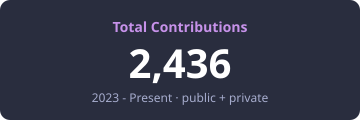

<h2 align="center">👋 Hi there, I'm Cesar Alexander</h2>

  <b>Software & Data Engineer @ TransNort</b> · Monterrey, México

  I build reliable cloud data workflows and operational systems on <b>Microsoft Azure</b> and <b>Google Cloud Platform</b>: 
  SQL Server, BigQuery, Python, REST APIs, Samsara telematics, CDC replication, batch processing and production automation.

  

<h2 align="center">💼 Experience</h2>

- 🚚 **Software & Data Engineer · TransNort** *(July 2026 - Present)*: Operational data workflows integrating Samsara telematics, SQL services, REST APIs and Azure. Idempotent batch imports, cache invalidation, concurrency handling, and automated reporting pipelines on Azure Functions and GitHub Actions.
- 🔧 **Developer Analyst · Grupo DEACERO** *(May 2026 - July 2026)*: Diagnosed production issues by tracing SQL Server execution flows and applying controlled SQL corrections.
- 📊 **Data Engineer Intern · Grupo DEACERO** *(March 2025 - May 2026)*: Migrated mission-critical ETL from SQL Server to BigQuery, built a Salesforce-to-BigQuery replication architecture with Google Datastream, and operated CDC replication pipelines.

<h2 align="center">✨ Some projects</h2>

- 💰 **Saldito** Mobile-first personal finance app with budgets, savings goals, cash-flow forecasting and spending analytics. *(Astro, FastAPI, PostgreSQL, Supabase)*
- 🍳 [PSell Kitchen Dashboard](https://psell-dashboard.vercel.app) Real-time Kanban kitchen dashboard with bidirectional sync via Supabase Realtime and PowerSync.
- 🃏 [VLRCards](https://vlrcards.com) FIFA-style rating system and player database for VALORANT, powered by a Python ETL pipeline and FastAPI.
- 🏦 **Secure Banking Ledger** RESTful API for financial transactions with JWT authentication. *(C# .NET, MySQL)*
- 🌐 [Portfolio](https://github.com/cesaralexanderds/portfolio) Personal portfolio built with Astro and Tailwind CSS.
- 🌸 [Lily Game](https://github.com/cesaralexanderds/lily-game) Clicker game about growing a lily, in plain HTML, CSS and JavaScript.

<h2 align="center">🌱 My Skills</h2>

<h4 align="center">💻 Programming languages</h4>

<h4 align="center">📚 Frameworks and Libraries</h4>

<h4 align="center">☁ Cloud and Data</h4>

<h4 align="center">⚙ Tools</h4>

<h2 align="center">🎓 Education</h2>

  <b>B.S. in Computer Science</b> · Universidad Autónoma de Nuevo León (FCFM) 
  Certifications: Advanced Web Development Applications (US-IT), Basic Data Science (Google) 
  Spanish (Native) · English (C1)

<h2 align="center">📫 Contact</h2>

